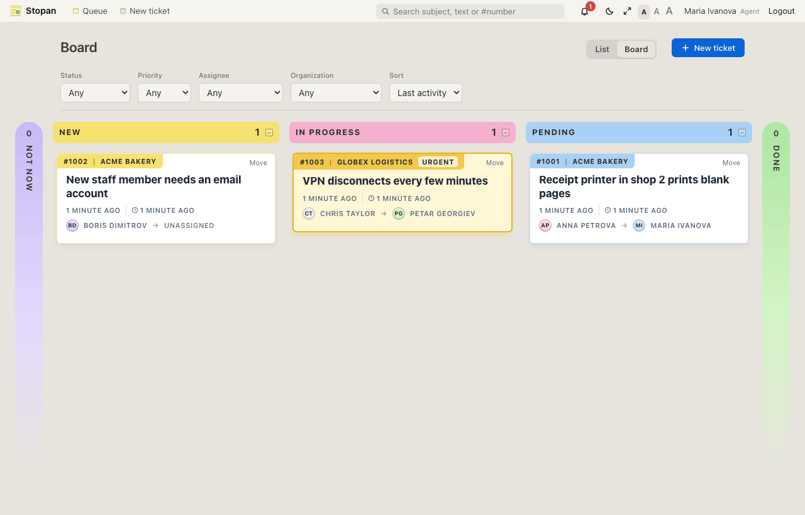
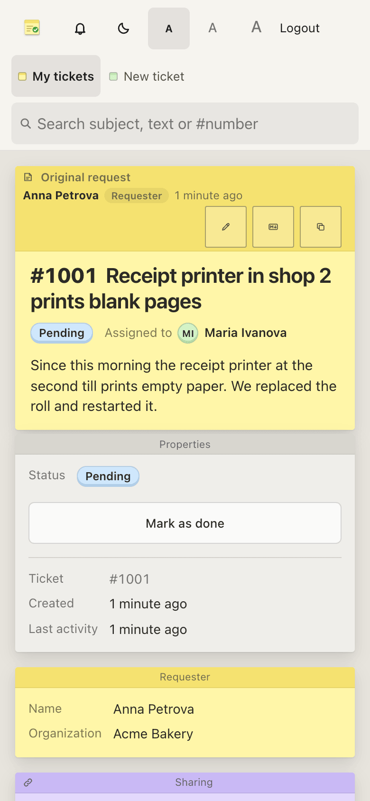
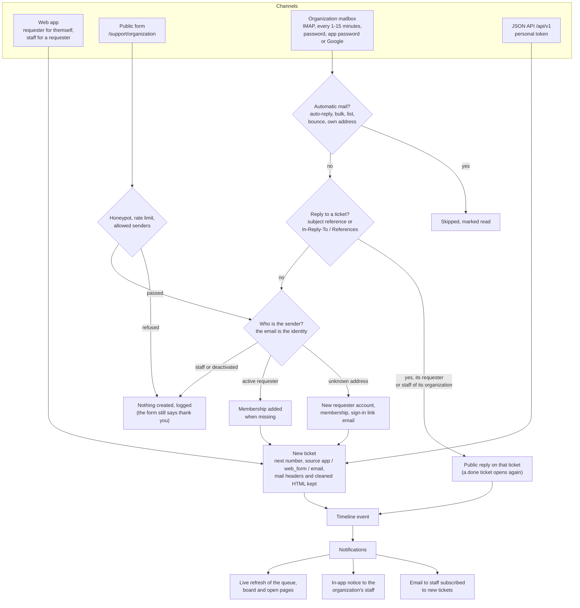

# Stopan

A service desk. Customers ("requesters") belong to organizations and open
tickets; agents triage, answer and resolve them in a shared queue;
administrators manage users, roles and organizations. Every change to a
ticket is kept in its timeline, and requesters only ever see their own
tickets and the public part of each timeline.

The UI is in English, Bulgarian and German (following the browser, or a
switch in the menu bar and on the account page), has a light and
a dark theme and three text sizes, and keeps the macOS Stickies look of the
notes app it started from (g0no). Turbo Drive makes page changes feel
instant.




| Ticket page for an agent | Requester on a phone |
|---|---|
|  |  |


The screenshots use the fictional data from `make demo`.

## How tickets come in

Four channels lead to the same ticket, timeline and notifications. The
email address is the identity on the public form and in the mailbox
(`specs/public-form.md`, `specs/organization-mail.md`); the app and the
API act with the signed-in user's or the token's rights (`specs/roles.md`,
`specs/api.md`).



## Features

- **Roles** - requester, agent, administrator; requesters and agents work
  the tickets of the organizations they belong to, administrators all
  (`specs/roles.md`).
- **Organizations and memberships** - requesters open tickets only for
  organizations they belong to and lose access when removed.
- **Tickets** - number (`#1001`), subject, description, status (new, in progress,
  pending, not now, done), priority (low to urgent), requester, assignee,
  organization, timestamps, attachments (`specs/tickets.md`).
- **Agent queue** - colour-coded views (all unsolved, assigned to me,
  unassigned, pending, not now, done, all) with counts, filters by status,
  priority, assignee and organization that apply at once, sort, pagination
  (`specs/queues.md`).
- **Board** - a Fizzy-like kanban of tickets by status for staff: colour
  columns, collapsed pills for Not now and Done, golden urgent cards, drag and
  drop or a Move menu (`specs/board.md`).
- **Search** - by text or ticket number from the menu bar on every page.
- **My tickets** - the requester's open / done / all lists.
- **Timeline** - public replies, staff-only internal notes, and an
  append-only audit log of status, priority and assignee changes
  (`specs/timeline.md`). The request and replies can be edited in place;
  edits are marked and staff see the earlier versions. Any message can be
  written in Markdown, rendered safely, with clickable task lists
  (`specs/markdown.md`); double-click edits in place, a copy box copies
  the text, earlier versions show word-by-word changes and can be
  restored. A wide layout switch sits next to the theme switch.
- **Attachments** - up to 5 files of 10 MB from an allow-list of types,
  served only after the ticket's visibility check; images, PDFs and text
  files open in a preview dialog, everything else downloads
  (`specs/attachments.md`).
- **Email notifications** - requesters hear about public replies and
  status changes, assignees about replies, notes and assignment, and staff
  can opt in to every new ticket; never about their own actions, never
  internal content to requesters, in each user's language. SMTP from
  `SMTP_*` environment variables. The same notifications appear in the
  app under a bell in the menu bar and on a notifications page, both
  updating live over Action Cable (`specs/notifications.md`).
- **Assignment** - one-click "Take" and an assignee menu in the queue
  (`specs/tickets.md`).
- **Sharing** - a secret read-only link to a ticket, optionally with a
  password; it shows only the public conversation, never internal notes;
  the shared page and the ticket's Sharing panel show live how many have
  the link open; administrators see and stop every shared link
  (`specs/sharing.md`).
- **Admin** - dashboard, users (roles, memberships, deactivation,
  impersonation with a banner and a record), organizations and members
  (`specs/admin.md`).
- **Mail per organization** - each organization can send through its own
  SMTP and have an IMAP mailbox whose mail becomes tickets and replies;
  passwords are stored encrypted (`specs/organization-mail.md`).
- **Public request page** - `/support/<organization>` lets anyone send a
  request without an account; the email address is the identity and new
  requesters get a one-time sign-in link (`specs/public-form.md`).
- **JSON API** - `/api/v1` with personal tokens made on the account page
  (read-only or read and write, optional expiry), with the same rights as
  the web app: tickets, replies, files, sharing, notifications, reports
  and, for administrators, users, organizations and settings
  (`specs/api.md`). Example:
  `curl -H "Authorization: Bearer $STOPAN_TOKEN" https://<host>/api/v1/tickets`
  (the token in an environment variable, never in a file or the history).
- **Secure defaults** - scoped queries everywhere (404 for tickets you may
  not see), per-role strong parameters, CSRF protection, Content Security
  Policy, account lockout, closed sign-up in production, ticket text
  filtered from logs.

What comes later (email ingestion, SLAs, automation, API,
reporting, agent groups, ...) is listed in `specs/roadmap.md`.

## Requirements

- Ruby 4.0 (see `.ruby-version`) and Bundler, first on `PATH` (macOS ships
  Ruby 2.6; with Homebrew: `export PATH=/opt/homebrew/opt/ruby/bin:$PATH`), or
- Docker with the compose plugin

## Run locally

```sh
make run            # http://localhost:3000
```

`make run` installs gems, prepares `storage/development.sqlite3`, creates
`.env` with a random `ADMIN_PASSWORD` on first use (`bin/setup-env`), and
creates the administrator `admin` from it when that user does not exist.
Sign in with `admin` (or the email in `ADMIN_EMAIL`) and the password from
`.env`.

Example data for trying it out (development only):

```sh
DEMO_PASSWORD=choose-a-password make demo
```

This adds two organizations, two agents, three requesters and a few tickets;
every demo user signs in with `DEMO_PASSWORD` (see `specs/auth.md`).

## Run with Docker

```sh
make docker-up          # http://localhost:3000 (creates .env like make run)
make docker-logs
make docker-down
```

Databases and uploaded files live in the `storage` volume. See
`specs/docker.md`.

## Development

```sh
make help     # all targets
make check    # rubocop, brakeman, gitleaks and the test suite; must pass before a commit
make hooks    # once per clone: gitleaks pre-commit hook (needs gitleaks)
make audit    # known-vulnerability check for gems
```

In development, emails (password reset, notifications) are written to
`tmp/mails/` instead of being sent. Production sends through SMTP when
`SMTP_ADDRESS` is set (`.env.example`, `specs/notifications.md`).

Specs (`specs/`) are the source of truth; `todo/todo.md` is the work list
and `session/` holds the handoff notes between working sessions.

## Security Note

Ticket text and attachments are customer data: keep `storage/` backed up and
private, keep sign-up closed on a public host (`REGISTRATION_OPEN`), and keep
`.env` out of git (it is ignored). Report suspected security problems to the
maintainer privately rather than in a public issue.
