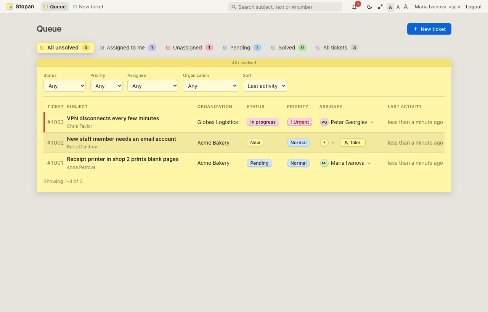
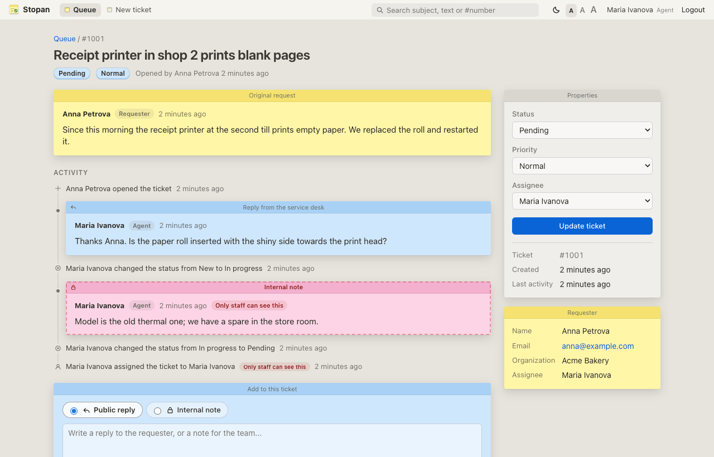
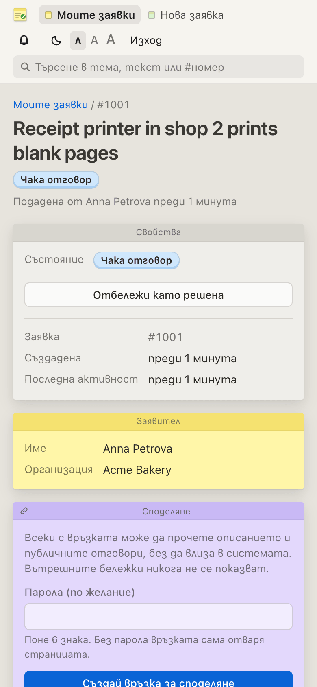
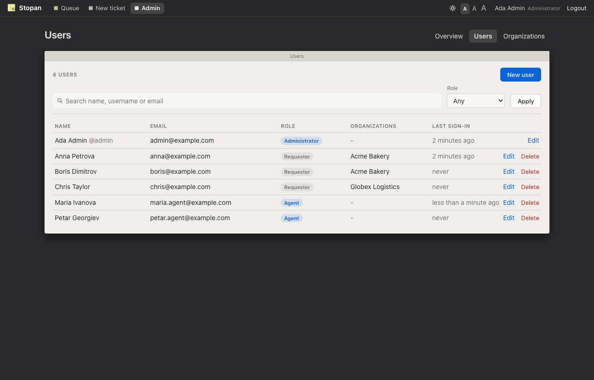

# Stopan

A service desk. Customers ("requesters") belong to organizations and open
tickets; agents triage, answer and resolve them in a shared queue;
administrators manage users, roles and organizations. Every change to a
ticket is kept in its timeline, and requesters only ever see their own
tickets and the public part of each timeline.

The UI is in English and Bulgarian (following the browser), has a light and
a dark theme and three text sizes, and keeps the macOS Stickies look of the
notes app it started from (g0no). Turbo Drive makes page changes feel
instant.



| Ticket page for an agent | Requester on a phone, in Bulgarian |
|---|---|
|  |  |



The screenshots use the fictional data from `make demo`.

## Features

- **Roles** - requester, agent, administrator (`specs/roles.md`).
- **Organizations and memberships** - requesters open tickets only for
  organizations they belong to and lose access when removed.
- **Tickets** - number (`#1001`), subject, description, status (new, open,
  pending, resolved, closed), priority (low to urgent), requester, assignee,
  organization, timestamps, attachments (`specs/tickets.md`).
- **Agent queue** - views (all unsolved, assigned to me, unassigned,
  pending, solved, all) with counts, filters by status, priority, assignee
  and organization, search by text or number, sort, pagination
  (`specs/queues.md`).
- **My tickets** - the requester's open / solved / all lists with search.
- **Timeline** - public replies, staff-only internal notes, and an
  append-only audit log of status, priority and assignee changes
  (`specs/timeline.md`).
- **Attachments** - up to 5 files of 10 MB from an allow-list of types,
  always downloaded, only after the ticket's visibility check
  (`specs/attachments.md`).
- **Email notifications** - requesters hear about public replies and
  status changes, assignees about replies, notes and assignment, and staff
  can opt in to every new ticket; never about their own actions, never
  internal content to requesters, in each user's language. SMTP from
  `SMTP_*` environment variables (`specs/notifications.md`).
- **Admin** - dashboard, users (roles, memberships, deactivation),
  organizations and members (`specs/admin.md`).
- **Secure defaults** - scoped queries everywhere (404 for tickets you may
  not see), per-role strong parameters, CSRF protection, Content Security
  Policy, account lockout, closed sign-up in production, ticket text
  filtered from logs.

What comes later (email ingestion, SLAs, automation, API,
reporting, agent groups, ...) is listed in `specs/roadmap.md`.

## Requirements

- Ruby 4.0 (see `.ruby-version`) and Bundler, first on `PATH` (macOS ships
  Ruby 2.6; with Homebrew: `export PATH=/opt/homebrew/opt/ruby/bin:$PATH`), or
- Docker with the compose plugin

## Run locally

```sh
make run            # http://localhost:3000
```

`make run` installs gems, prepares `storage/development.sqlite3`, creates
`.env` with a random `ADMIN_PASSWORD` on first use (`bin/setup-env`), and
creates the administrator `admin` from it when that user does not exist.
Sign in with `admin` (or the email in `ADMIN_EMAIL`) and the password from
`.env`.

Example data for trying it out (development only):

```sh
DEMO_PASSWORD=choose-a-password make demo
```

This adds two organizations, two agents, three requesters and a few tickets;
every demo user signs in with `DEMO_PASSWORD` (see `specs/auth.md`).

## Run with Docker

```sh
make docker-up          # http://localhost:3000 (creates .env like make run)
make docker-logs
make docker-down
```

Databases and uploaded files live in the `storage` volume. See
`specs/docker.md`.

## Development

```sh
make help     # all targets
make check    # rubocop, brakeman, gitleaks and the test suite; must pass before a commit
make hooks    # once per clone: gitleaks pre-commit hook (needs gitleaks)
make audit    # known-vulnerability check for gems
```

In development, emails (password reset, notifications) are written to
`tmp/mails/` instead of being sent. Production sends through SMTP when
`SMTP_ADDRESS` is set (`.env.example`, `specs/notifications.md`).

Specs (`specs/`) are the source of truth; `todo/todo.md` is the work list
and `session/` holds the handoff notes between working sessions.

## Security Note

Ticket text and attachments are customer data: keep `storage/` backed up and
private, keep sign-up closed on a public host (`REGISTRATION_OPEN`), and keep
`.env` out of git (it is ignored). Report suspected security problems to the
maintainer privately rather than in a public issue.
